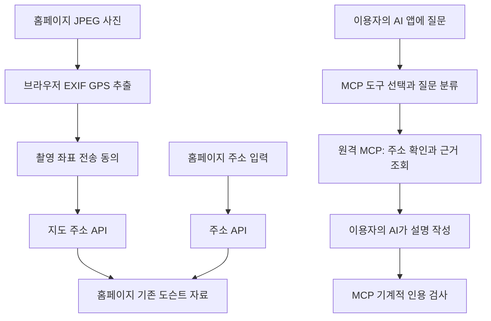

# 이용자 AI 실행 검증 보고서

검증일: 2026-11-06 (한국 시간). 기준 코드: GitHub main `d216679`, 검증 브랜치 `codex/verify-client-ai`. 운영 배포·main 병합 없음.

## 최종 결론

**전체 목표는 PARTIAL입니다.** MCP가 모델 API 없이 근거를 제공하는 것은 시험했지만, ChatGPT·Claude·Gemini의 실제 계정에서 설명이 생성되고 이용 한도가 소비되는 과정은 시험하지 못했습니다. 홈페이지에서 사진·주소를 입력해도 AI 앱이 자동으로 호출되지 않습니다.



위 두 흐름을 자동 연결하는 기능은 없습니다. MCP가 이용자의 구독을 넘겨받는 것도 아닙니다. 서버의 `pickScenes`는 질문 단어와 기록을 비교하는 규칙 기반 선택이며 AI 분류기가 아닙니다. `questionType`을 보내는 주체와 최종 답변 작성 주체는 호출한 AI입니다. 반환값의 `executor`나 `serverAiCalls:0` 자체는 실사용 증거가 아닙니다.

## 코드와 배포 구분

- `vercel.json`: Next.js 배포 구성. 실제 Vercel 프로젝트·공개 URL·연결 브랜치는 이 파일만으로 알 수 없습니다.
- `.openai/hosting.json`: Sites 프로젝트 `appgprj_6acd53ff39588191b6c07a038ece0771`, D1 `DB`, R2 `BUCKET`, MCP capability.
- 문서에 적힌 `https://seoul-place-history.xeonire.chatgpt.site/mcp`에 initialize 요청: **401 Unauthorized**. 인증 벽이 있다는 사실만 확인됐으며 실행 코드 버전·도구 목록은 확인하지 못했습니다.
- 로컬 주소 `http://127.0.0.1:5173/`와 운영 서버를 동일한 배포로 간주하지 않습니다. 서버 내부 테스트는 실제 라우트 `app/mcp/route.ts`를 실행했으며 인터넷 호스팅 연결 실증과 다릅니다.
- 현재 라우트는 인증을 Sites dispatch에 맡긴다고 명시합니다. Vercel 배포 시 이 보호가 자동 적용된다는 보장은 없습니다. 공개 배포 전 별도 접근 통제·호출 제한·Host/Origin 정책 확인이 필요합니다.

## 실제 수행한 검사

1. `npm run test:audit`: 실제 MCP POST 라우트, 초기화·8개 도구 목록·근거 조회·사진 GPS 파서·지도 예외·응답 검증을 검사합니다.
2. 신규 라우트 테스트는 `fetch`를 전부 차단합니다. 시험용 키로 서명한 서울 위치 5개에 `get_place_history`, `prepare_place_answer`, `generate_place_answer`를 호출해 기존 데이터가 반환됨을 확인했습니다. 이는 공식 주소 검색 성공을 흉내 낸 결과가 아니라, **주소 검증 이후 단계만 검사하는 fixture 테스트**입니다. 테스트에서 외부 통신 시도 0건입니다.
3. 별도 공식 주소 API 실조회는 주소 API 도메인만 허용했습니다. 운영자 모델 키는 로드하지 않았습니다. 아래 7개 검색에서 외부 요청 7회, 차단 시도 0회, 모델 호출 0회였습니다. 후보 token으로 근거 조회까지 실행했습니다. 복수 후보의 첫 항목은 시험 편의상 선택했으며 사용자 승인 완료를 뜻하지 않습니다.

| 검색어 | 서울 후보 수 | 조회 결과 | 반환 근거 ID 예 |
|---|---:|---|---|
| 사직로 161 | 2 | ready, 사용자 선택 필요 | seoul-museum-2666 |
| 왕십리로 83 | 1 | ready | claim:E000427 |
| 삼양로173길 7 | 1 | ready | seoul-museum-1340 |
| 북촌로 53 | 2 | ready, 사용자 선택 필요 | bukchon:0 |
| 양화로 160 | 1 | ready | seoul-museum-3811 |
| 성수동 | 10 | ready, 사용자 선택 필요 | seoul-museum-4852 |
| 부산광역시 중앙대로 100 | 0 | 서울 외 후보 3개 제외 | 없음 |

공식 검색 뒤 건물 기록 없음/법정동만 확인되는 경우의 실증은 완료하지 못했습니다. 테스트 환경의 서명 fixture와 지도 API 모의 응답 검사를 실조회로 간주하지 않습니다.

## 운영자 모델 호출 경로와 수정

수정 전 홈페이지 `DocentHome → AISummaryPanel → /api/ai-summary → generateAISummary → openaiFetch → api.openai.com`, `DocentStory → /api/docent/narration → narrateScenes → openaiFetch`, 영문 번역도 같은 제공기관으로 이어졌습니다. AI 키가 설정되어 있으면 운영자 비용이 발생할 수 있었습니다.

수정 후 자동 요약·해설 UI 호출을 제거하고 해당 공개 POST API는 410으로 차단했습니다. 번역 함수는 메모리/R2의 기존 번역만 반환하며 모델 생성 코드는 제거했습니다. 사진·지도·기존 자료 장면은 유지했습니다. 사진 좌표 전송 전 확인 창을 추가했습니다. `.dev.vars`가 이 main에서 미추적 파일로 노출되어 Git 무시 규칙을 추가했고 비밀값은 커밋하지 않았습니다.

MCP 호출 그래프: `POST → handleMcpMessage → execute → searchAddresses/verifyAddress/mapAddress/getDocentStory/getFullDocentStory → preparePlaceAnswer/pickScenes/validateAnswer`. 조회에 주소 API·지도 API가 사용될 수 있고 통계는 D1을 사용할 수 있습니다. MCP 경로에 OpenAI·Anthropic·Gemini 모델 호출은 발견되지 않았습니다. 기존 AI 요약·해설 라이브러리는 보존되지만 공개 라우트는 호출하지 않습니다.

| 지표 | 결과와 범위 |
|---|---|
| A 운영자 모델 API 호출 | 시험한 MCP 경로 0건. 운영 전체 청구 대시보드는 미측정 |
| B 이용자 AI의 실제 생성 | 세 AI 모두 NOT TESTED |
| C 이용자 모델 토큰/한도 | 미측정. MCP로 수치가 전달된다는 근거 없음 |
| D 호스팅·DB·주소 API 비용 | 별도 비용. 실제 청구액 미측정 |

## 사진 GPS

JPEG 최대 20MB, 브라우저 `readPhotoGps`가 EXIF를 읽습니다. HEIC·GPS 없는 JPEG는 주소 입력으로 대체합니다. 자동 테스트에서 양쪽 TIFF 바이트 순서, GPS 없음·손상 파일과 좌표 관련 지도 예외를 검사합니다. 실제 iPhone/Android, 갤러리 공유 중 메타데이터 제거, AI 앱 사진 첨부의 GPS 전달은 **NOT TESTED**입니다. MCP 도구는 이미지 원본을 받지 않고 좌표 두 개만 받습니다. 원본 사진이 MCP로 자동 전송된다고 설명하면 안 됩니다. 촬영 위치와 피사체 위치도 다를 수 있습니다.

## 세 AI 공식 지원과 실증 구분

공식 문서 확인일: 2026-11-06. 계정 메뉴와 정책은 바뀔 수 있습니다.

| 서비스 | 공식 문서상 연결 조건 | 이번 실제 계정 실증 |
|---|---|---|
| ChatGPT | 맞춤 MCP 연결은 웹에서 설정. Business/Enterprise/Edu 권한에 따라 생성·공유. Pro 읽기/조회 연결 안내도 있으므로 계정 기능 확인 필요. 모바일 연결 설정은 웹 전용으로 명시 | NOT TESTED |
| Claude | 원격 서버에 Anthropic 클라우드에서 연결. Free 포함 지원 플랜 안내, Free 맞춤 연결 1개. 연결은 웹에서 설정하고 모바일 사용은 앱에서 확인 필요 | NOT TESTED |
| Gemini 앱 | 미국·18세 이상·개인 계정·영어·활동 저장 조건. 웹에서 등록 후 웹/모바일 사용. 한국 일반 사용자 요구는 현재 문서상 충족하지 못함 | 한국 일반 조건 미지원, 계정 실증 NOT TESTED |
| Gemini CLI/API | 일반 Gemini 앱과 별개. 사용자의 자격증명·과금 계정 확인 필요 | NOT TESTED |

출처: [ChatGPT 맞춤 MCP](https://help.openai.com/en/articles/12584461-connecting-custom-mcp-servers-in-chatgpt), [Claude 원격 MCP](https://support.claude.com/en/articles/11175166-get-started-with-custom-connectors-using-remote-mcp), [Gemini 맞춤 앱](https://support.google.com/gemini/answer/17209137?co=GENIE.Platform%3DDesktop&hl=en-PR).

## 계정에서 재현할 순서

먼저 운영자에게 **실제로 접속 가능한 HTTPS MCP 주소와 인증 방식**을 확인하세요. 위 401 주소에 임의로 로컬 토큰을 전송하지 마세요.

1. ChatGPT 웹에서는 Plugins의 맞춤 MCP 연결 기능을 엽니다. 계정/조직에 기능과 권한이 있는지 확인하고 서버 URL과 요구되는 인증으로 연결합니다. 메뉴가 없으면 해당 계정에서 테스트 불가로 기록하세요.
2. Claude 웹: Customize → Connectors → + Add → Add custom connector → 서버 URL → Continue → 서버가 요구하는 인증 → Add. 대화의 + → Connectors에서 활성화합니다.
3. Gemini는 위 지역·계정 조건을 충족할 때만 Settings → Connected Apps → Custom apps → 서버 URL → Next를 사용합니다. 한국 계정을 CLI 성공으로 대체해 앱 성공이라고 표시하지 마세요.
4. 대화에서 “서울 왕십리로 83을 search_place로 찾아줘. 후보를 내가 선택한 다음 질문 유형을 분류하고 prepare_place_answer의 자료만 써서 설명해 줘. 문단마다 자료 ID와 원문 URL을 달고 validate_place_answer로 검사해 줘.”라고 입력하세요.
5. 앱의 도구 실행 내역에서 실제 도구 이름과 반환된 자료 ID를 확인합니다. 최종 답변이 그 ID를 인용하는지 대조합니다. 서버 반환 JSON만 보인 것은 AI 답변 완료가 아닙니다.
6. 사진은 우선 홈페이지에서 GPS를 확인하고 좌표 전송에 동의한 뒤 주소를 확인합니다. 확인한 주소를 본인의 AI 대화에 **수동으로 전달**합니다. AI 앱에 사진을 직접 첨부하는 방식은 GPS 전달이 확인될 때까지 주소 입력으로 대체하세요.
7. AI별로 계정 플랜, 시각, MCP URL, 도구명, 익명 요청 ID, 자료 ID, 최종 답변 인용 ID, 도구 사용 화면을 남기세요. 사진 원본·정확한 사적 주소·token은 보고서에서 제외하세요. 토큰 수가 보이지 않으면 미측정으로 기록합니다.

## 요구사항별 최종 판정

| 항목 | 판정 | 사유 |
|---|---|---|
| 1 휴대폰 GPS 사진 위치 확인 | PARTIAL | 파서/좌표 단위 검사만 수행, 실제 휴대폰 미검증 |
| 2 주소로 서울 위치 확인 | YES | 공식 API 5개 서울 주소와 제외 사례 실조회 |
| 3 홈페이지 두 입력이 MCP로 이어짐 | NO | /api/address, /api/map-address 등 웹 API 사용 |
| 4 ChatGPT 자체 분류·생성 | NOT TESTED | 계정 연결·최종 답변 기록 없음 |
| 5 Claude 자체 분류·생성 | NOT TESTED | 계정 연결·최종 답변 기록 없음 |
| 6 Gemini 자체 분류·생성 | NOT TESTED | 한국 앱 조건 미지원, 대체 환경 미시험 |
| 7 MCP 운영자 모델 호출 없음 | PARTIAL | 로컬 코드/차단 시험 통과, 운영 환경 미측정 |
| 8 홈페이지 운영자 AI 호출 없음 | PARTIAL | 이번 브랜치에서 차단·API 시험 완료, 운영 미배포 |
| 9 MCP가 사용자 실제 토큰 수 확인 | NO | 현재 프로토콜/코드에서 소비량 제공 안 됨 |
| 10 한국 일반 휴대폰에서 동일 흐름 | NO | AI별 지원 조건이 다르고 전체 흐름 미실증 |

결론적으로 “모든 모바일 AI에서 오직 이용자 토큰으로 자동 실행 완료”라는 제출 문구는 아직 사용할 수 없습니다. “MCP의 자료 조회는 운영자 모델 호출 없이 검증했고, AI별 실사용은 별도 확인 단계”라고 설명하는 것이 증거와 일치합니다.

## 재현 명령과 증거 파일

Node.js 22.19 이상과 저장소 의존성을 설치한 뒤 PowerShell에서 실행합니다.

```powershell
npm run test:audit
npm run typecheck
node --experimental-transform-types --import ./tests/ts-resolver.mjs scripts/audit-live-addresses.mjs
```

마지막 명령은 로컬 .dev.vars의 JUSO_API_KEY만 읽어 공식 주소 API를 호출합니다. 모델 API와 다른 외부 통신은 차단합니다. 원본 token은 출력하지 않습니다. 실제 사용자 주소나 사진을 자동 수집하지 않습니다.

검사 결과: 33개 통과, 타입 검사 통과. 로그: [자동 테스트](verification/client-ai-tests.log), [공식 주소 실조회](verification/address-live.log). 도구 목록의 이름이나 serverAiCalls라는 자체 표기가 아니라 실제 네트워크 가로채기 및 자료 ID로 확인했습니다. 호출한 AI 앱과 운영 계정의 청구 내역은 확인하지 않았습니다.
`npm run build`는 Vinext의 analyze client references 단계에서 장시간 진행되지 않아 중단했습니다. 빌드 통과로 보고하지 않습니다. 브라우저 시각 검증과 운영 배포도 이번 검증에 포함되지 않았습니다.
